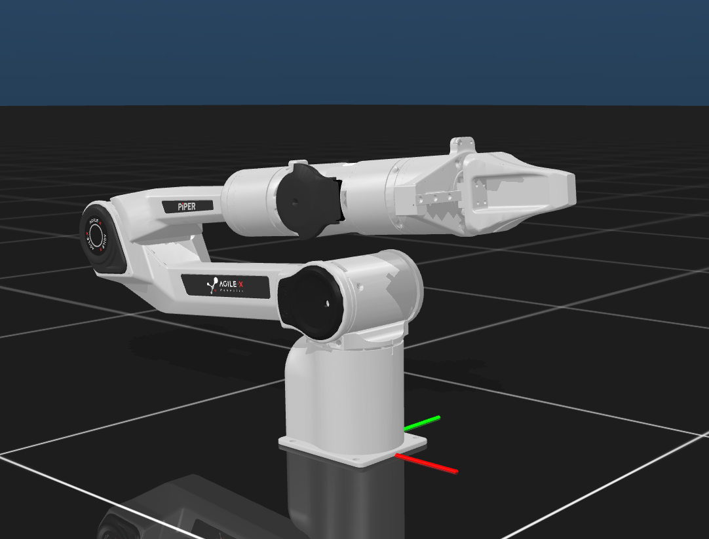
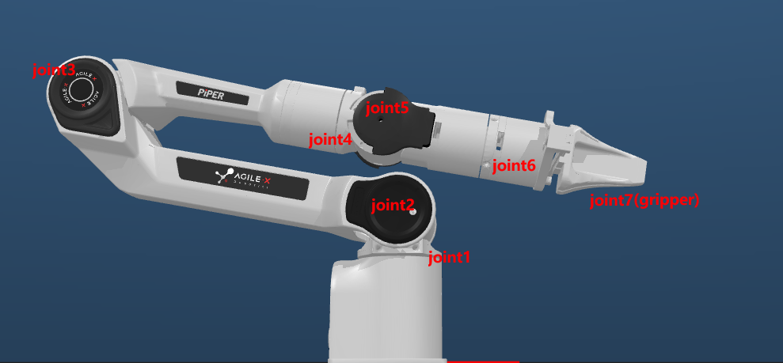
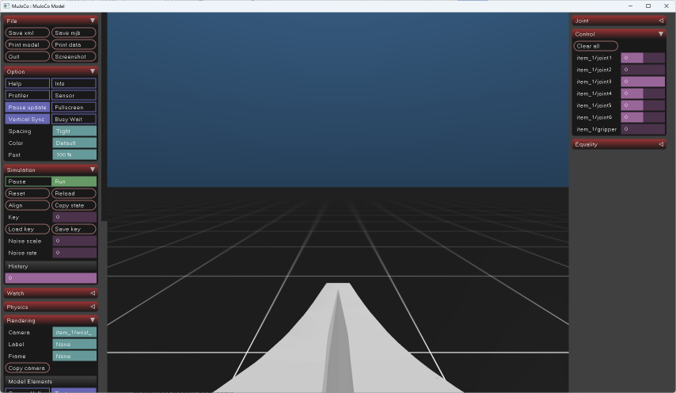

## AgileX PiPER 描述文件 (MJCF)



### 文件架构

```
|
|- assets: 模型文件
|- PIPER.png: 本体图像
|- PIPER.xml: MJCF 文件
|- scene.xml: 引用示例
|- Variant: 拓展模型
```

### 本仓控制语义

`gripper` position actuator 控制两指总开口 `0..0.105 m`，通过 `gear=2` 映射到 `joint7`；`joint8 = -joint7` 的 equality 与两指各自 `0.0525 m` 限位保持不变。为近似保持迁移前的 joint-space 动态，夹爪使用 `kp=10`、`kv=1.25`、`forcerange=-5 5`。

### 资料来源

https://github.com/google-deepmind/mujoco_menagerie/tree/main/agilex_piper

本目录保留上游 MIT 许可与 `Copyright (c) 2024 RosenYin` 声明，完整
文本见 [`LICENSE`](LICENSE)。本仓修改了夹爪控制语义、场景相机和部分路径；
这些修改不改变上游资产的许可归属。

### 拓展资源

1. Unimanual_PIPER_withTable: 单臂（带操作台）
2. Bimanual_PIPER_withTable_aloha: 双臂（带操作台，挑战杯构型）
3. Bimanual_PIPER_withTable_aloha2: 双臂（带操作台，睿尔曼构型）

### 关节对照图

 

### 相机视角图

 