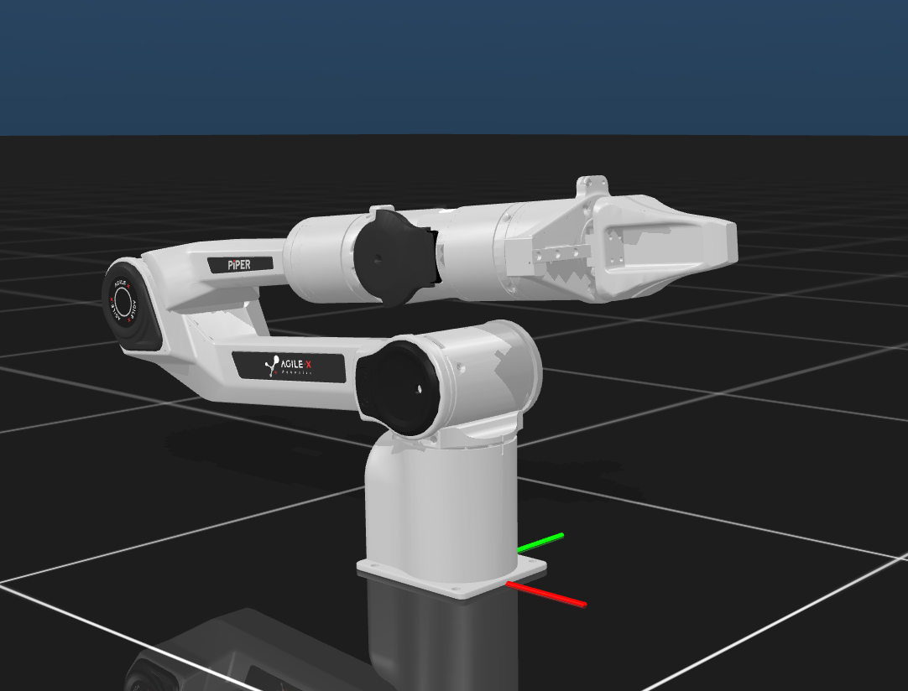

# agilex_piper 构型说明

## 构型概览

Agilex PiPER 单机械臂构型，配备末端夹爪并支持 CAN 总线控制。

- **构型类别**：机械臂

## 支持引擎

| 引擎 | 支持情况 | 依据 |
|---|---|---|
| 真机 | 支持 | `src/robots_agilex_piper/` |
| MuJoCo | 支持 | `assets/mjcf/piper_mujoco/scene.xml` |
| Isaac Sim / Isaac Lab | 支持 Isaac Sim 接入 | `assets/usd/PIPER.usda` |

## 模型资产

- [`assets/mjcf/piper_mujoco/scene.xml`](assets/mjcf/piper_mujoco/scene.xml)
- [`assets/mjcf/piper_mujoco/PIPER.xml`](assets/mjcf/piper_mujoco/PIPER.xml)
- [`assets/mjcf/piper_mujoco/Variant/Bimanual_PIPER_withTable_aloha/Bimanual_PIPER_withTable_aloha.xml`](assets/mjcf/piper_mujoco/Variant/Bimanual_PIPER_withTable_aloha/Bimanual_PIPER_withTable_aloha.xml)
- [`assets/glb/piper.glb`](assets/glb/piper.glb)
- [`assets/glb/piper_upstream/PIPER.glb`](assets/glb/piper_upstream/PIPER.glb)
- [`assets/usd/PIPER.usda`](assets/usd/PIPER.usda)

> “支持”仅表示仓库中存在对应驱动、模型或可执行工作流；实际运行仍需满足硬件、SDK 与运行环境要求。
